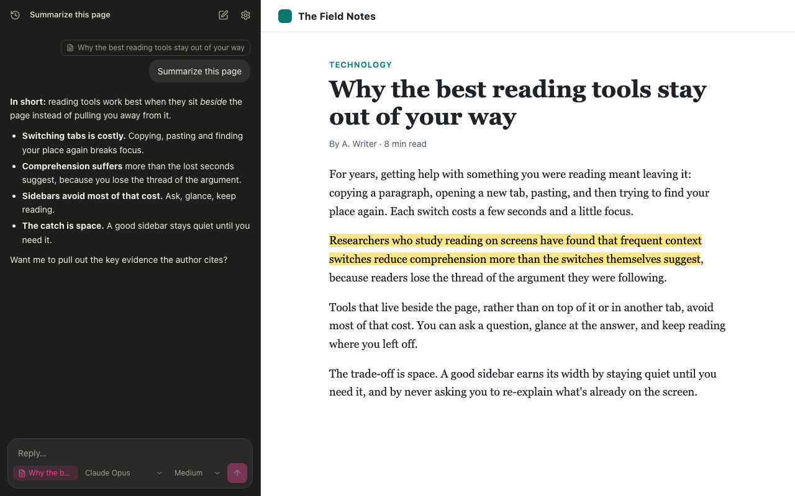

# AI Sidebar

Chat with **Claude** and **Gemini** in a sidebar next to any web page, in **Chrome or Firefox**, using the accounts
you already have (Claude Pro/Max, or your Google account). No API keys.



## Install

**You need:** a Mac, and [Claude Code](https://claude.com/product/claude-code) (for Claude) and/or
[Antigravity](https://antigravity.google/download) (for Gemini).

### 1. Set up the companion app

Paste this into **Terminal**:

```bash
curl -fsSL https://raw.githubusercontent.com/Juan337492/aisidebar/main/install.sh | bash
```

This installs a small helper app and starts it automatically at login. The helper is what lets the sidebar reach your
Claude and Google accounts. It also checks that Node.js, Claude Code and Antigravity are installed, and tells you what's
missing. ([Read the script first](install.sh) if you like.)

### 2. Add the extension

Download it from the **[latest release](https://github.com/Juan337492/aisidebar/releases/latest)**:

- **Chrome, Edge, Brave or Arc:** download **[ai-sidebar-chrome.zip](https://github.com/Juan337492/aisidebar/releases/latest/download/ai-sidebar-chrome.zip)**
  and unzip it. Go to `chrome://extensions`, turn on **Developer mode** (top right), click **Load unpacked**, and
  choose the unzipped folder.
- **Firefox:** download **[ai-sidebar-firefox.zip](https://github.com/Juan337492/aisidebar/releases/latest/download/ai-sidebar-firefox.zip)**.
  Go to `about:debugging#/runtime/this-firefox`, click **Load Temporary Add-on…** and choose the zip. Firefox removes
  it when it restarts. When a signed `ai-sidebar-firefox.xpi` is listed on the release page, use that instead for a
  permanent install: `about:addons` → ⚙️ → **Install Add-on From File…**

### 3. Connect and sign in

Click the AI Sidebar toolbar icon (or press **Alt+Shift+A**), then:
1. Click **Connect**, then click **Allow** in the popup on your Mac.
2. Click **Sign in with Claude** or **Sign in with Google**, and log in on their official page.

That's it. Try **Use page** to ask about the page you're on, or right-click selected text → **Explain**.

<details>
<summary>Windows or Linux</summary>

The installer works, but auto-start is macOS-only. Keep `aisidebar-companion start` running in a terminal, and in the
sidebar use **Settings → Manual setup** with the token from `aisidebar-companion token`.
</details>

<details>
<summary>How it works</summary>

```
Browser extension (sidebar)  ──HTTP + token──▶  Companion (127.0.0.1:8765)  ──▶  claude CLI        (Claude subscription)
                                                                              └─▶  antigravity CLI   (Google account)
```

Browsers don't let extensions start programs, so the companion runs the official CLIs, which are already signed in to
your accounts. The extension only talks to the companion on your own computer.
</details>

## Signing in

Click **Sign in with Claude** or **Sign in with Google** in the sidebar (or in Settings → Providers). The provider's
**official sign-in page** opens in your browser, and you log in there with your usual account (password, email code,
2FA, SSO). The sidebar notices when you're done. The extension and companion never see your password: the CLIs keep
their own sign-in, exactly as when you run `claude auth login` yourself. **Sign out** and **Change account** sign that
CLI out on the whole computer, including other apps that use it.

On other platforms, or if you prefer, use **Manual setup** in Settings and paste the token from
`npm run companion:token`.

## Features

- Streaming chat with model and effort pickers (Claude Opus/Sonnet/Haiku, plus every Gemini model your account has)
- **Use page**: sends the current tab's text with your message (asks for page access the first time)
- Right-click a selection to **Explain** it or **Ask AI Sidebar** about it; right-click a page to **Summarize this page**
- Chat history with search and pinning. Switching providers mid-chat carries the conversation over.
- T3-style provider settings: on/off toggle, sign-in status, account, CLI version, models, display name
- Light and dark themes, plus custom instructions

## Security

- New connections must be approved in a native macOS dialog that names the extension asking.
- The companion listens on `127.0.0.1` only. Every request needs the pairing token, and requests from web pages
  (non-extension `Origin`) or with an unexpected `Host` (DNS rebinding) are rejected.
- The CLIs run in an empty folder (`~/.aisidebar/workspace`). Claude runs with **no tools** and Antigravity runs in
  `--sandbox` mode, so a chat can't edit your files.
- Page text is only read when you turn on **Use page** or use the right-click menu.
- These CLIs are meant for your own personal use. Check each provider's terms before sharing this with other people.

## Development

```bash
npm install
npm run companion            # run the companion from source
npm run dev:firefox          # opens Firefox with the extension, hot reload
npm run dev                  # same for Chrome
npm run build                # production builds in extension/.output/
```

To load a build by hand: **Chrome:** open `chrome://extensions`, turn on Developer mode, click Load unpacked, and
pick `extension/.output/chrome-mv3`. **Firefox:** open `about:debugging`, click Load Temporary Add-on, and pick
`extension/.output/firefox-mv3/manifest.json`.

### Releasing

Bump `version` in `extension/package.json` (and `companion/package.json` if it changed), then run `npm run release`.
That builds everything and publishes a GitHub Release with `aisidebar-companion.tgz`, `ai-sidebar-chrome.zip` and
`ai-sidebar-firefox.zip`, plus `ai-sidebar-firefox.xpi` if a Mozilla-signed build is in `extension/.output/signed/`
(make one with `web-ext sign --channel unlisted`). The download links and `install.sh` always use the latest release.

## Layout

```
companion/src/   server.ts (HTTP/NDJSON), providers/claude.ts, providers/antigravity.ts, cli.ts
extension/       WXT + React + Tailwind; entrypoints/{background,sidepanel,options}, components/, lib/
```
